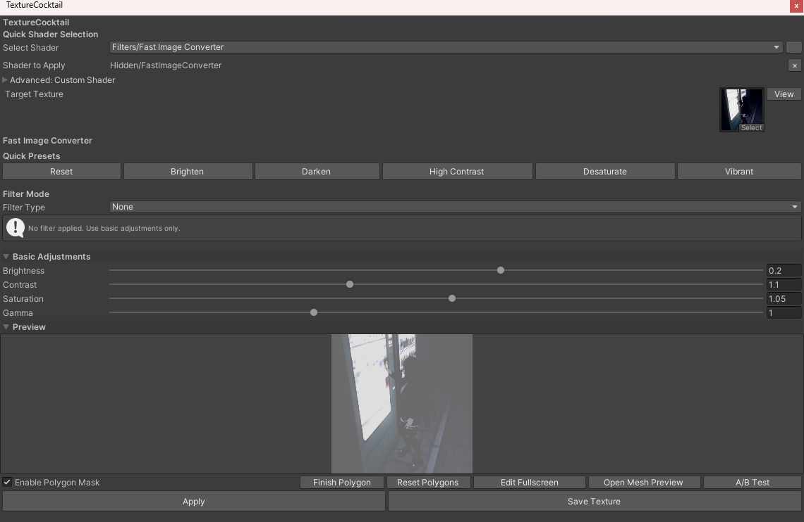
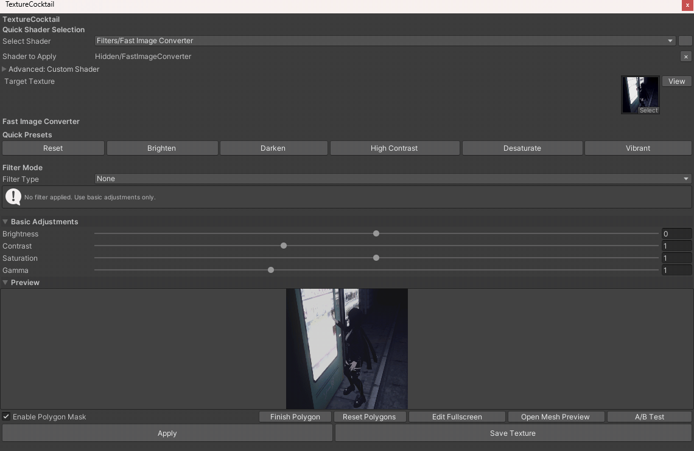
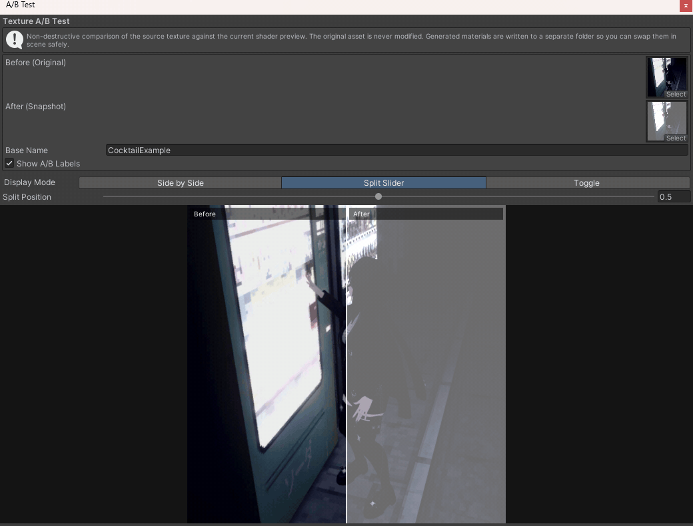
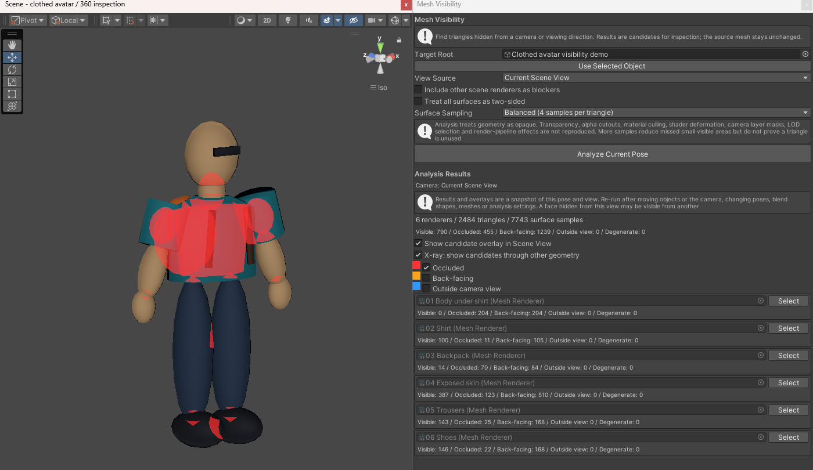
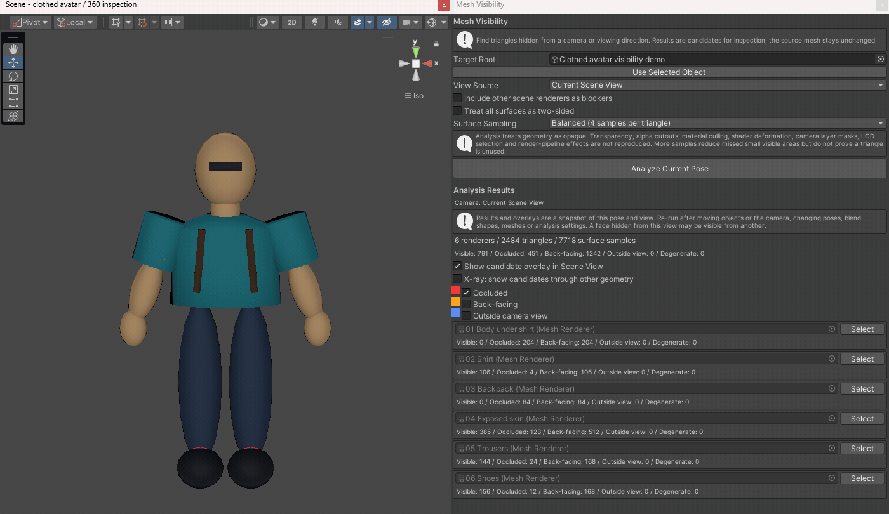

# TextureCocktail

Unity 에디터에서 텍스처의 색상과 효과를 조절하고, 원본과 비교한 뒤 PNG로 저장하는 도구입니다. 아바타·오브젝트에서 특정 시점에 가려지는 메시와 폴리곤 후보도 확인할 수 있습니다.

[설치](#설치) · [첫 텍스처 편집](#첫-텍스처-편집) · [가려진 폴리곤 찾기](#가려진-폴리곤-찾기) · [개발·배포](docs/development.md)



이 문서의 이미지와 GIF는 Unity 에디터의 실제 실행 화면입니다. [캡처 환경과 예제](docs/media/capture-notes.md)를 확인할 수 있습니다.

## 설치

패키지의 최소 Unity 버전은 **2022.3**이며, 이 저장소의 프로젝트 버전은 **2022.3.22f1**입니다. TextureCocktail은 `luticalab.core` 패키지를 함께 사용합니다.

### VCC에서 설치

1. VRChat Creator Companion에서 **Settings → Packages → Add Repository**를 엽니다.
2. 아래 저장소 주소를 넣고 **Add**를 누른 뒤 표시된 패키지 정보를 확인해 저장소를 추가합니다.
3. 사용할 프로젝트의 패키지 관리 화면에서 **TextureCocktail**을 추가합니다. 필요한 Core 의존성도 함께 설치합니다.
4. Unity에서 해당 프로젝트를 열고 **LuticaLab → TextureCocktail** 메뉴를 확인합니다.

```text
https://skid-cocktail.luticalab.dev/index.json
```

[VCC 저장소 추가 안내](https://vcc.docs.vrchat.com/guides/community-repositories/) · [최신 릴리스](https://github.com/LuticaCANARD/TextureCocktail/releases/latest)

<details>
<summary>ZIP으로 직접 설치하기</summary>

릴리스에서 TextureCocktail ZIP과 해당 릴리스의 Core ZIP을 받습니다. 압축을 풀어 각 `package.json`이 아래 위치에 오도록 프로젝트에 배치한 뒤 Unity를 엽니다.

```text
YourProject/
  Packages/
    luticalab.core/package.json
    luticalab.texturecocktail/package.json
```

같은 패키지를 VCC와 수동 복사로 중복 설치하지 마세요. VCC에서 설치한 프로젝트는 VCC의 업데이트 기능을 사용합니다.

</details>

## 첫 텍스처 편집

1. Project 창에서 편집할 텍스처를 선택하고 우클릭 **TextureCocktail → Open with TextureCocktail**을 누릅니다. 창을 먼저 열었다면 **Target Texture / 대상 텍스처**에 텍스처를 드래그합니다.
2. **Quick Shader Selection / 빠른 셰이더 선택**에서 **Filters/Fast Image Converter**를 고릅니다.
3. **Brighten**, **High Contrast**, **Vibrant** 등의 프리셋을 누르거나 밝기·대비·채도·감마를 조절합니다. 아래 미리보기에서 결과를 확인합니다.
4. **Save Texture / 텍스처 저장**을 누르고 `example_edited.png`처럼 새 이름으로 저장합니다. 저장창은 기본적으로 `Assets`와 원본 이름을 제안하므로, 원본을 유지하려면 다른 파일명을 선택하세요.
5. 저장한 PNG를 사용할 머티리얼의 텍스처 슬롯에 지정합니다.



창의 언어는 **LuticaLab → Setting → Language**에서 바꿀 수 있습니다. 메뉴 경로와 프리셋 이름 등 일부 항목은 영어로 표시됩니다.

### 원본과 결과 비교하기

미리보기 아래 **A/B Test / A/B 테스트**를 누르면 원본과 편집 결과를 함께 볼 수 있습니다. **Side by Side / 나란히 보기**, **Split Slider / 분할 슬라이더**, **Toggle / 토글** 중 비교 방식을 고르세요.



A/B 창의 After 이미지는 창을 열 당시의 스냅샷입니다. 편집 값을 바꿨다면 메인 창에서 **A/B Test**를 다시 눌러 갱신하세요. 비교용 머티리얼과 Quad를 생성할 수도 있으며, 기본 출력 폴더는 `Assets/TextureCocktailABTest`입니다.

### 일부 영역만 편집하기

미리보기에서 **Enable Polygon Mask / 폴리곤 마스크 사용**을 켜고 점을 세 개 이상 찍은 뒤 첫 점을 클릭하거나 폴리곤 마무리 버튼을 누릅니다. 닫힌 영역에만 효과가 적용됩니다. 꼭짓점이나 폴리곤 안쪽을 드래그해 영역을 조정하고, **폴리곤 초기화**로 지울 수 있습니다.

작은 영역은 **전체화면 편집**에서 확대해 작업하세요. **LuticaLab → TextureCocktail Mesh Preview**에서는 대상 Renderer, 머티리얼 슬롯, 텍스처 속성을 지정해 메시 위의 편집 영역을 확인할 수 있습니다.

## 작업에 맞는 도구 선택

메인 창의 빠른 셰이더 선택에서 다음 도구를 사용할 수 있습니다.

| 하고 싶은 작업 | 선택할 도구 | 시작 방법 |
| --- | --- | --- |
| 밝기·대비·채도 조절, 블러·선명화 | **Filters/Fast Image Converter** | 텍스처 지정 → 프리셋 또는 Filter Type 선택 → 값 조절 |
| 색온도·노출·색감 보정 | **Color/Color Correction** | 프리셋 선택 → 그레이딩 모드와 색상 값 조절 |
| 색상·채도·명도 변경 | **Color/HSV Adjustment** | HSV 변환과 오프셋 조절 |
| 텍스처 두 장 합성 | **Effects/Texture Blender** | 베이스와 블렌드 텍스처 지정 → 합성 모드·양 조절 |
| 픽셀화·하프톤·카툰 효과 | **Effects/Artistic Effects** | 효과 선택 → 해당 효과의 값 조절 |
| 엣지·색상 특징 추출 | **Analysis/Feature Extractor** | 추출 모드 선택 → 채널·민감도 조절 |
| 높이 이미지에서 노멀맵 생성 | **Generators/Normal Map Generator** | 텍스처 지정 → 강도·높이 스케일 조절 |

### 여러 텍스처에 같은 보정 적용하기

**LuticaLab → TextureCocktail Batch Processor**를 열고 셰이더를 지정합니다. Project에서 텍스처들을 선택한 뒤 **Add Selected Textures**로 추가하고, 공통 설정과 **Output Path**를 확인해 **Process All Textures**를 누릅니다.

일괄 처리의 공통 설정은 밝기·대비·채도·감마이며, 지정한 셰이더에 해당 속성이 있을 때 적용됩니다. 기본 출력은 `Assets/ProcessedTextures/<원본이름>_processed.png`입니다. 같은 이름의 결과는 덮어쓸 수 있으므로 작업별 출력 폴더를 지정하세요.

## 가려진 폴리곤 찾기

카메라나 지정 방향에서 보이지 않는 삼각형을 확인하는 기능입니다. **실제 Light를 추가할 필요는 없습니다.** 메시를 자동 삭제하지 않으며, 정리 여부를 판단할 후보를 표시합니다.



1. **Hierarchy**에서 아바타나 오브젝트의 루트를 선택합니다. Project 창의 프리팹 파일 대신 씬에 배치된 오브젝트를 사용하세요.
2. **LuticaLab → TextureCocktail Mesh Visibility**를 엽니다. Mesh Preview 창의 **Find Hidden Polygons… / 보이지 않는 폴리곤 찾기…**에서도 열 수 있습니다.
3. **View Source / 시점 기준**을 고릅니다. 현재 Scene 뷰, 씬의 Camera, 지정 방향을 사용할 수 있습니다. 지정 방향에는 모델을 향하는 광선의 진행 방향을 입력합니다.
4. **Surface Sampling / 표면 검사 정밀도**를 고릅니다. 기본 균형 모드는 삼각형당 4지점을 검사하며, 빠르게는 1지점, 정밀은 7지점입니다. 필요하면 **다른 씬 메시의 가림도 검사**를 켭니다.
5. **Analyze Current Pose / 현재 포즈 분석**을 누릅니다. 활성화된 자식 MeshRenderer와 SkinnedMeshRenderer를 현재 포즈로 함께 분석합니다.
6. Renderer별 개수와 Scene 뷰의 색상을 확인합니다. **Select / 선택**으로 해당 오브젝트를 찾고, **X-ray / 투시 표시**로 다른 메시 뒤의 후보도 볼 수 있습니다.

### 예제: 옷 속 몸통과 배낭을 360도로 확인하기

티셔츠를 입고 배낭을 멘 마네킹을 한 바퀴 돌려 보면, **옷 속 몸통**과 **정면에서만 가려진 배낭**을 구별할 수 있습니다. X-ray를 켜면 옷에 덮인 몸통 후보가 드러납니다. 배낭도 정면에서는 가려지지만 뒤에서 다시 분석하면 보이는 부분이 확인되므로, 정면 결과만 보고 삭제해서는 안 됩니다.



GIF는 현재 Scene 뷰를 360도 회전하면서 **각 시점에서 다시 분석**한 시연입니다. 뒤에서는 잠깐 X-ray를 꺼 실제로 보이는 배낭 외형도 보여줍니다. 실제 작업에서도 Scene 뷰를 돌린 뒤 **Analyze Current Pose**를 눌러 결과를 갱신하세요. 옷 안쪽 후보도 다른 포즈나 의상 조합에서 노출되는지 확인한 후 정리 여부를 결정합니다.

직접 따라 하려면 [예제 생성기](docs/examples/MeshVisibilityDemo.cs)를 프로젝트의 `Assets/Editor`에 복사하세요. 이름 없는 Untitled 씬이 열려 있다면 먼저 저장한 뒤 **LuticaLab → Examples → Create Mesh Visibility Demo**를 실행합니다. 별도의 모델 다운로드 없이 예제 씬을 만들 수 있습니다. [예제 환경과 재현 순서](docs/media/capture-notes.md#메시-예제-재현)에 필요한 설정을 정리했습니다.

| 색상·분류 | 의미 |
| --- | --- |
| 빨강 · Occluded / 가려짐 | 검사한 지점이 다른 면에 가려짐 |
| 주황 · Back-facing / 뒷면 | 검사 시점의 반대쪽을 향함 |
| 파랑 · Outside view / 시야 밖 | 지정 카메라의 시야 밖에 있음 |
| Visible / 보임 | 검사한 지점에서 보이는 부분이 발견됨 |
| Degenerate / 유효하지 않은 면 | 면적이 없는 등 분석에 적합하지 않은 삼각형 |

**결과는 분석 당시의 시점과 포즈에 한정됩니다.** 다른 각도나 애니메이션에서는 보일 수 있으므로, 후보 전체를 불필요한 메시로 간주하면 안 됩니다. 카메라·오브젝트·포즈·블렌드셰이프·설정을 바꾼 뒤에는 다시 분석하세요.

불투명한 형상을 기준으로 검사하며 투명도, 알파 컷아웃, 머티리얼 컬링, 셰이더 변형, 카메라 레이어, LOD와 렌더 파이프라인 효과를 재현하지 않습니다. 정밀도를 높여도 작은 노출 영역을 놓칠 수 있습니다. 분석과 색상 표시는 원본 메시를 변경하지 않습니다.

## 다른 유틸리티와 문제 해결

- **LuticaLab → Quick Access Toolbar**: 텍스처를 지정하고 프리셋 버튼을 눌러 처리 결과를 저장합니다.
- **LuticaLab → Texture Optimizer**: 폴더를 **Scan Textures**로 검사한 뒤 권장 설정을 검토합니다. Fix 버튼은 실제 Texture Importer 설정을 변경합니다.
- **LuticaLab → AI Connector**: 별도로 실행 중인 Ollama 또는 OpenAI 호환 서버를 연결하고 모델을 선택해 프롬프트를 보냅니다. 텍스처 편집 기능 자체에는 AI 서버가 필요하지 않습니다.

| 증상 | 확인할 내용 |
| --- | --- |
| LuticaLab 메뉴가 없음 | Core와 TextureCocktail이 모두 설치됐는지, Console에 컴파일 오류가 있는지 확인합니다. |
| 미리보기가 나오지 않음 | 대상 텍스처와 빠른 셰이더 선택을 확인하고 미리보기 영역을 펼칩니다. |
| 저장한 텍스처가 오브젝트에 반영되지 않음 | 저장한 PNG를 머티리얼의 텍스처 슬롯에 지정합니다. |
| A/B 비교가 이전 결과를 보여줌 | 메인 창에서 A/B Test를 다시 열어 스냅샷을 갱신합니다. |
| 메시 분석 버튼이 비활성화됨 | 씬 오브젝트인지, Scene 뷰 또는 Camera가 있는지, 지정 방향이 0이 아닌지 확인합니다. |

Windows 단축키는 **Ctrl+Alt+T**(메인 창), **Ctrl+Alt+B**(일괄 처리)입니다. macOS에서는 **Cmd+Option+T/B**를 사용합니다.

## 더 알아보기

- [개발·확장·테스트·릴리스 자동화](docs/development.md)
- [플러그인 작성 가이드](Packages/luticalab.texturecocktail/PLUGIN_GUIDE.md)
- [빠른 이미지 변환 가이드](Packages/luticalab.texturecocktail/FAST_IMAGE_CONVERSION_KR.md) · [English guide](Packages/luticalab.texturecocktail/FAST_IMAGE_CONVERSION.md)
- [색보정·합성·효과 상세](Packages/luticalab.texturecocktail/NEW_FEATURES.md)
- [문제 제보](https://github.com/LuticaCANARD/TextureCocktail/issues)

TextureCocktail은 LuticaLab의 SKID-Project 하위 프로젝트입니다.
