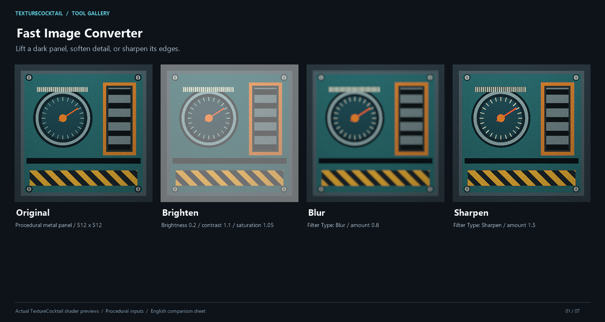
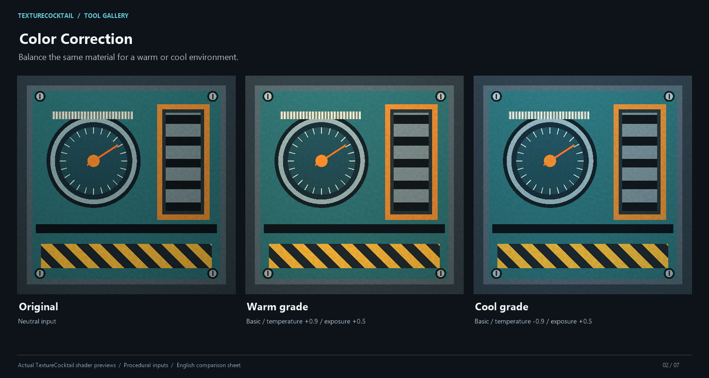
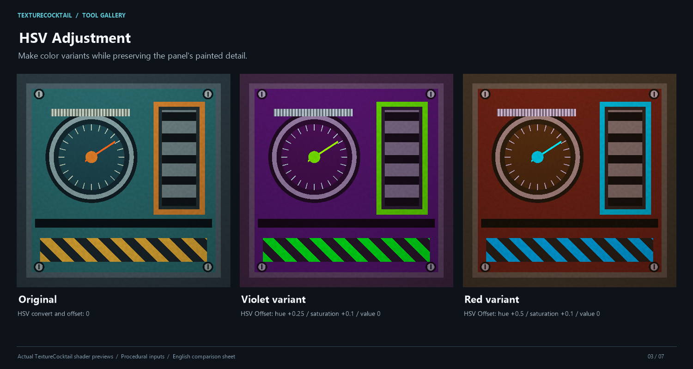
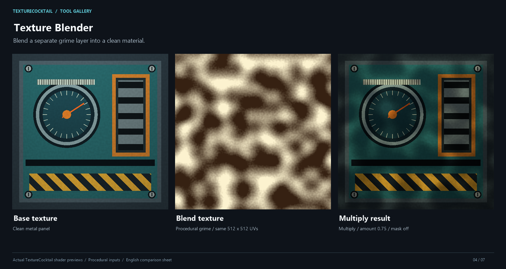
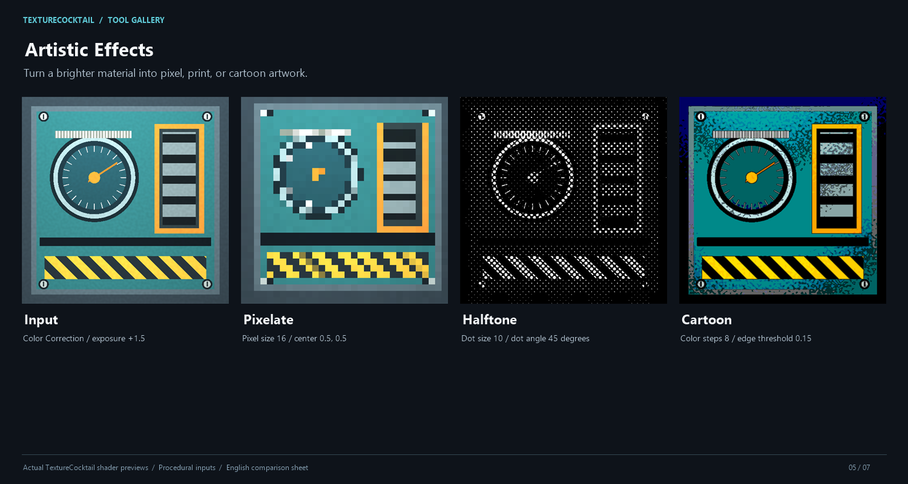
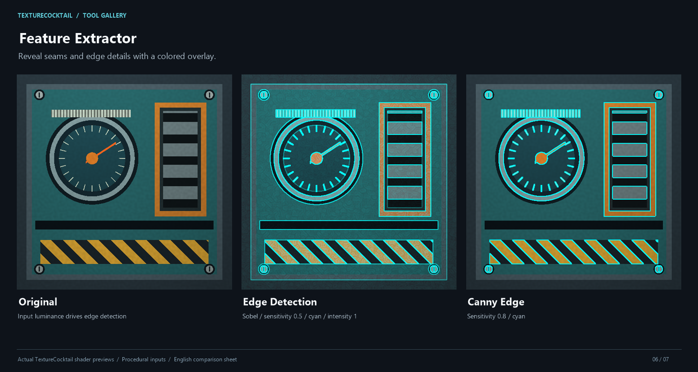
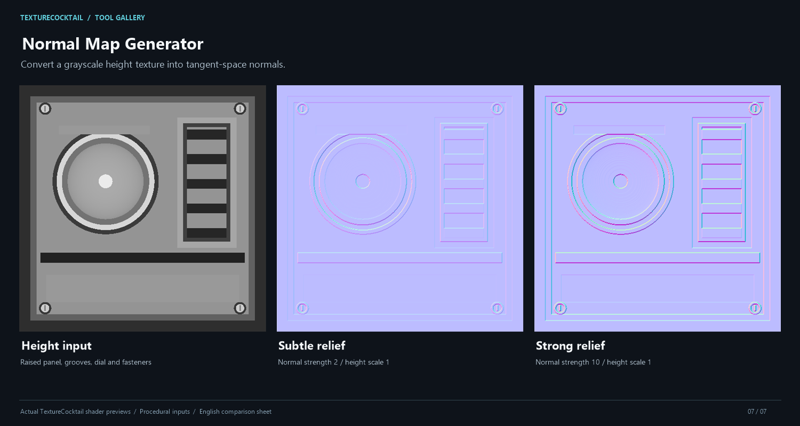

# TextureCocktail

[English](README.md) · [한국어](README.ko.md) · [日本語](README.ja.md) · **简体中文**

本文为简体中文 README。可通过上方链接切换文档语言；各语言版本共用带英文标签的截图、GIF 和工具对比图。

TextureCocktail 是一款 Unity 编辑器工具，可调整纹理颜色和效果、与原图对比，并将结果保存为 PNG。它还可以从多个方向检查虚拟形象或场景物体，找出始终被遮挡的多边形候选面。

[安装](#安装) · [第一次编辑纹理](#第一次编辑纹理) · [查找被遮挡的多边形](#查找被遮挡的多边形) · [开发与发布（韩语）](docs/development.md)


截图和 GIF 均为 Unity 编辑器的实际运行画面。下方的工具对比图使用 TextureCocktail 实际渲染的着色器处理结果。详见[截图环境与示例（韩语）](docs/media/capture-notes.md)。

## 安装

软件包最低支持 **Unity 2022.3**，本仓库项目使用 **2022.3.22f1**。TextureCocktail 需要同时安装 `luticalab.core` 软件包。

### 通过 VCC 安装

1. 在 VRChat Creator Companion 中打开 **Settings → Packages → Add Repository**。
2. 输入下面的仓库地址，点击 **Add**，确认显示的软件包信息后添加仓库。
3. 在目标项目的软件包管理页面添加 **TextureCocktail**，并一并安装所需的 Core 依赖。
4. 在 Unity 中打开该项目，确认出现 **LuticaLab → TextureCocktail** 菜单。

```text
https://skid-cocktail.luticalab.dev/index.json
```

[VCC 添加仓库指南（英语）](https://vcc.docs.vrchat.com/guides/community-repositories/) · [最新版本](https://github.com/LuticaCANARD/TextureCocktail/releases/latest)

<details>
<summary>使用 ZIP 手动安装</summary>

从发布页面下载 TextureCocktail ZIP 以及同一版本发布中提供的 Core ZIP。解压后放入项目，确保各自的 `package.json` 位于以下路径，再打开 Unity。

```text
YourProject/
  Packages/
    luticalab.core/package.json
    luticalab.texturecocktail/package.json
```

不要通过 VCC 和手动复制重复安装同一个软件包。通过 VCC 安装的项目，请使用 VCC 的更新功能。

</details>

## 第一次编辑纹理

1. 在 Project 窗口中选择要编辑的纹理，右键点击 **TextureCocktail → Open with TextureCocktail**。如果已打开工具窗口，将纹理拖到 **Target Texture**（目标纹理）字段。
2. 在 **Quick Shader Selection**（快速选择着色器）中选择 **Filters/Fast Image Converter**。
3. 点击 **Brighten**、**High Contrast**、**Vibrant** 等预设，或调整亮度、对比度、饱和度和伽马值。在下方预览中查看结果。
4. 点击 **Save Texture**（保存纹理），以 `example_edited.png` 等新文件名保存。保存对话框默认建议使用 `Assets` 文件夹和原文件名；如需保留原图，请使用不同的文件名。
5. 将保存的 PNG 指定到所需材质的纹理槽中。


工具界面支持**英语、韩语、日语和简体中文**。首次启动时，无论操作系统使用什么语言，界面均默认显示**英语**。打开 **LuticaLab → Setting → Language** 并选择 **简体中文**，即可切换为中文界面。手动选择的语言会在重启 Unity 后保留。菜单路径、着色器标识符和外部插件名称可能仍以英语显示。文档保留英文按钮名以便对照截图，简体中文界面会显示相应译名（如 **Brighten → 提亮**）。

### 对比原图与结果

点击预览下方的 **A/B Test**，即可同时查看原图和编辑结果。可选择 **Side by Side**（并排显示）、**Split Slider**（滑块分割）或 **Toggle**（切换）模式。


A/B 窗口中的 After 图像是打开窗口时的快照。更改编辑参数后，请在主窗口再次点击 **A/B Test** 更新快照。也可以生成用于对比的材质和 Quad，默认输出文件夹为 `Assets/TextureCocktailABTest`。

### 仅编辑局部区域

在预览中启用 **Enable Polygon Mask**（启用多边形遮罩），放置至少三个点，再点击第一个点或 **Finish Polygon** 按钮闭合多边形。效果仅应用于闭合区域内。拖动顶点或多边形内部可调整区域，点击 **Reset Polygons** 可清除多边形。

编辑较小区域时，可使用 **Edit Fullscreen** 放大操作。在 **LuticaLab → TextureCocktail Mesh Preview** 中，指定目标 Renderer、材质槽和纹理属性，即可在网格上查看编辑区域。

## 按任务选择工具

主窗口的快速着色器选择器提供以下工具。

| 任务 | 工具 | 入门步骤 |
| --- | --- | --- |
| 调整亮度、对比度、饱和度，模糊或锐化 | **Filters/Fast Image Converter** | 指定纹理 → 选择预设或 Filter Type → 调整参数 |
| 调整色温、曝光和色彩 | **Color/Color Correction** | 选择预设 → 调整调色模式和颜色参数 |
| 调整色相、饱和度和明度 | **Color/HSV Adjustment** | 调整 HSV 变换和偏移量 |
| 混合两张纹理 | **Effects/Texture Blender** | 指定基础纹理和混合纹理 → 调整混合模式和混合量 |
| 像素化、半色调和卡通效果 | **Effects/Artistic Effects** | 选择效果 → 调整相应参数 |
| 提取边缘和颜色特征 | **Analysis/Feature Extractor** | 选择提取模式 → 调整通道和灵敏度 |
| 从高度图生成法线贴图 | **Generators/Normal Map Generator** | 指定纹理 → 调整强度和高度缩放 |

### 查看各工具的处理结果

这些示例使用程序生成的 512 × 512 金属控制面板纹理、污渍纹理和高度图。各结果均由 TextureCocktail 的实际着色器渲染，再将输入与输出排成带英文标签的对比图。可使用下列参数复现示例。生成步骤见[截图环境与示例（韩语）](docs/media/capture-notes.md)。

#### Fast Image Converter — 亮度与细节

提亮纹理、柔化细节或增强轮廓。示例对比 **Brighten** 预设（亮度 **0.2**、对比度 **1.1**、饱和度 **1.05**、伽马 **1**）、**Blur 0.8** 和 **Sharpen 1.5**。



#### Color Correction — 暖色与冷色版本

为同一物件制作暖色和冷色版本。两个示例均使用 **Basic** 调色和曝光 **+0.5**；暖色版本的色温为 **+0.9**，冷色版本为 **−0.9**。



#### HSV Adjustment — 更改表面颜色

在保留明暗变化的同时更改涂漆表面的颜色。HSV Convert 为 **0**，示例对比 HSV Offset **(0.25, 0.1, 0)** 和 **(0.5, 0.1, 0)**。



#### Texture Blender — 叠加污渍

将基础纹理与单独的污渍纹理混合，为物件添加使用痕迹。示例使用 **Multiply**，混合量 **0.75**，并关闭混合遮罩。



#### Artistic Effects — 改变物件风格

为使风格化后的细节保持清晰，先使用 Color Correction 的 **Basic** 模式和曝光 **+1.5** 提亮输入。示例对比中心为 **(0.5, 0.5)** 的 **Pixelate 16**、点大小 **10** 且角度 **45°** 的 **Halftone**，以及 **8** 级色阶、边缘阈值 **0.15** 的 **Cartoon**。



#### Feature Extractor — 查看边缘

提取面板轮廓，用于检查或图形效果。**Sobel** 的灵敏度为 **0.5**，**Canny** 为 **0.8**；两者均使用青色边缘，强度为 **1**。



#### Normal Map Generator — 生成表面凹凸

从灰度高度图生成法线贴图。在高度缩放均为 **1** 时，对比强度 **2** 和 **10**；更高的强度会更突出高度变化。



### 对多张纹理应用相同调整

打开 **LuticaLab → TextureCocktail Batch Processor** 并指定着色器。在 Project 窗口中选择纹理，点击 **Add Selected Textures** 添加，确认通用参数和 **Output Path**（输出路径），再点击 **Process All Textures**。

批处理的通用参数为亮度、对比度、饱和度和伽马，仅在所选着色器具有对应属性时生效。默认输出路径为 `Assets/ProcessedTextures/<原文件名>_processed.png`。同名结果可能被覆盖，请为不同任务设置各自的输出文件夹。

## 查找被遮挡的多边形

**从 X、Y、Z 三个轴的正负方向以及对角方向进行检查，只单独标记在所有已检查方向上都被遮挡的三角形。** 只要某个面在任意一个检查方向上可见，就会从候选中排除。无需添加实际的 Light 对象；工具不会删除网格，而是显示供您判断是否需要清理的候选面。


1. 在 **Hierarchy** 中选择虚拟形象或物体的根对象。请选择已放置在场景中的对象，而不是 Project 窗口中的预制体资源文件。
2. 打开 **LuticaLab → TextureCocktail Mesh Visibility**。也可在 Mesh Preview 窗口中点击 **Find Hidden Polygons…** 打开。
3. 将 **Analysis Mode**（分析模式）保留为默认的 **All directions (XYZ + diagonals)**。**Direction Coverage**（检查方向覆盖度）提供快速 26 方向、默认均衡 98 方向和精细 386 方向。提高精度时，会保留已有检查方向并添加更多方向。
4. 选择 **Surface Sampling**（表面采样精度）。默认均衡模式对每个三角形采样 4 个点，快速模式为 1 个点，精细模式为 7 个点。如有需要，可启用 **Include other scene renderers as blockers**，将场景中的其他网格也作为遮挡物。
5. 点击 **Analyze Current Pose**（分析当前姿态）。工具会按当前姿态一并分析处于活动状态且已启用的子级 MeshRenderer 和 SkinnedMeshRenderer。
6. 在 **XYZ ray checks** 中确认 **+X、-X、+Y、-Y、+Z、-Z** 分别是否完成检查，并查看各方向上可见的三角形数量。启用 **Show inspected XYZ ray directions** 后，Scene 视图中也会显示射线方向箭头。
7. 仅 **Hidden in all checked directions**（在所有已检查方向上均被遮挡）的候选面以**紫色**显示。使用 **X-ray** 可查看其他网格后方的候选面，点击 **Select** 可定位对应对象。

XYZ 检查并不限于水平方向旋转一周，还会检查上下方向在内的六个轴向及对角方向。方向标签表示**朝向模型的射线传播方向**。例如，+Z 射线从模型的 -Z 一侧射入。

### 示例：绕建筑旋转 360 度，检查始终被遮挡的多边形

示例对比一间小型工作室建筑中**厚墙内部的柱梁**与**通过门口可见的室内箱子表面**。由于合并了多个方向的结果，只要箱子上的某个面曾从门口被看到，就会被排除出候选。始终被墙体遮挡的面可通过 X-ray 单独检查。


GIF 演示的是**进行一次 98 方向分析后，保持该结果并将 Scene 视图旋转 360 度**。仅旋转检查视角时，无需重新分析。即使画面中可见的表面发生变化，在所有已检查方向上都被遮挡的候选面集合仍保持不变。

如需自行操作，将[示例生成脚本](docs/examples/MeshVisibilityDemo.cs)复制到项目的 `Assets/Editor`。如果当前有尚未命名的 Untitled 场景，请先保存，再执行 **LuticaLab → Examples → Create Mesh Visibility Demo**。无需另外下载模型，即可创建示例场景。所需设置见[示例环境与复现步骤（韩语）](docs/media/capture-notes.md#메시-예제-재현)。

| 所有方向的分析结果 | 含义 |
| --- | --- |
| Seen in any direction / 至少一个方向可见 | 至少一个检查方向发现了可见的采样点，因此从候选中排除 |
| 紫色 · Hidden in all checked directions / 所有已检查方向均被遮挡 | 在所有已检查方向上都被遮挡的候选面；仅这些面会被着色标记 |
| Unresolved / 无法确定 | 无法判定为所有已检查方向均被遮挡的面；从候选中排除 |
| Degenerate / 退化面 | 面积为零等不适合分析的三角形；从候选中排除 |

**“所有方向”指所选的 26、98 或 386 个检查方向，并不证明某个面在所有可能的视点上都绝对不可见。** 检查可能遗漏很小的可见区域或狭窄缝隙。如果建筑允许进入室内，也应从内部视点进行检查。修改对象、网格形状、姿态、混合形状（Blend Shape）、遮挡网格或分析设置后，需要重新分析。

### 仅检查特定相机或单一方向

原有的单视点检查可在 **Analysis Mode: Single view** 中使用。通过 **View Source** 选择当前 Scene 视图、场景中的 Camera 或指定方向。选择指定方向时，请输入朝向模型的射线传播方向。

| 单视点颜色与分类 | 含义 |
| --- | --- |
| 红色 · Occluded / 被遮挡 | 检查的采样点被其他面遮挡 |
| 橙色 · Back-facing / 背面 | 朝向与检查视点相反 |
| 蓝色 · Outside view / 视野外 | 位于指定相机的视野之外 |
| Visible / 可见 | 在检查的采样点中发现可见区域 |
| Degenerate / 退化面 | 面积为零等不适合分析的三角形 |

单视点结果仅对应分析时的视点和姿态。移动相机或 Scene 视图后，请重新分析。被建筑后墙遮挡的箱子，在正面门口或室内仍可能可见。

两种模式都将几何体视为不透明物体，不会复现透明度、Alpha 裁剪、材质剔除、着色器变形、相机图层、LOD 或渲染管线效果。分析和颜色标记不会修改原始网格。

## 其他实用工具与故障排查

- **LuticaLab → Quick Access Toolbar**：指定纹理，点击预设按钮，并保存处理结果。
- **LuticaLab → Texture Optimizer**：使用 **Scan Textures** 扫描文件夹，再检查建议的设置。Fix 按钮会实际修改 Texture Importer 设置。
- **LuticaLab → AI Connector**：连接另行运行的 Ollama 或兼容 OpenAI 的服务器，选择模型并发送提示词。纹理编辑功能本身不需要 AI 服务器。

| 问题 | 检查事项 |
| --- | --- |
| 没有 LuticaLab 菜单 | 确认 Core 和 TextureCocktail 均已安装，并检查 Console 是否存在编译错误。 |
| 未显示预览 | 检查目标纹理和快速着色器选择，并展开预览区域。 |
| 保存的纹理没有应用到物体上 | 将保存的 PNG 指定到材质的纹理槽中。 |
| A/B 对比仍显示之前的结果 | 在主窗口重新打开 A/B Test，以更新快照。 |
| 网格分析按钮不可用 | 确认分析目标是场景中的对象。在 Single view 模式下，请根据 View Source 的选择检查：使用 Scene 视图或 Camera 时，确认相应视图已打开或相机已指定；使用 Direction 时，确认方向不为零向量。 |

Windows 快捷键为 **Ctrl+Alt+T**（主窗口）和 **Ctrl+Alt+B**（批处理）。macOS 使用 **Cmd+Option+T/B**。

## 了解更多

- [开发、扩展、测试与发布自动化（韩语）](docs/development.md)
- [插件编写指南（英语）](Packages/luticalab.texturecocktail/PLUGIN_GUIDE.md)
- [快速图像转换指南（韩语）](Packages/luticalab.texturecocktail/FAST_IMAGE_CONVERSION_KR.md) · [英语指南](Packages/luticalab.texturecocktail/FAST_IMAGE_CONVERSION.md)
- [颜色校正、混合与效果详解（英语／韩语）](Packages/luticalab.texturecocktail/NEW_FEATURES.md)
- [反馈问题](https://github.com/LuticaCANARD/TextureCocktail/issues)

TextureCocktail 是 LuticaLab 的 SKID-Project 子项目。
